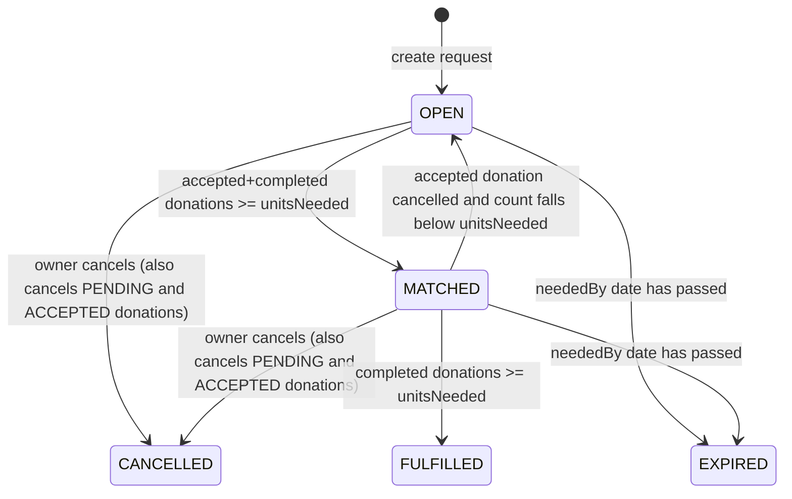
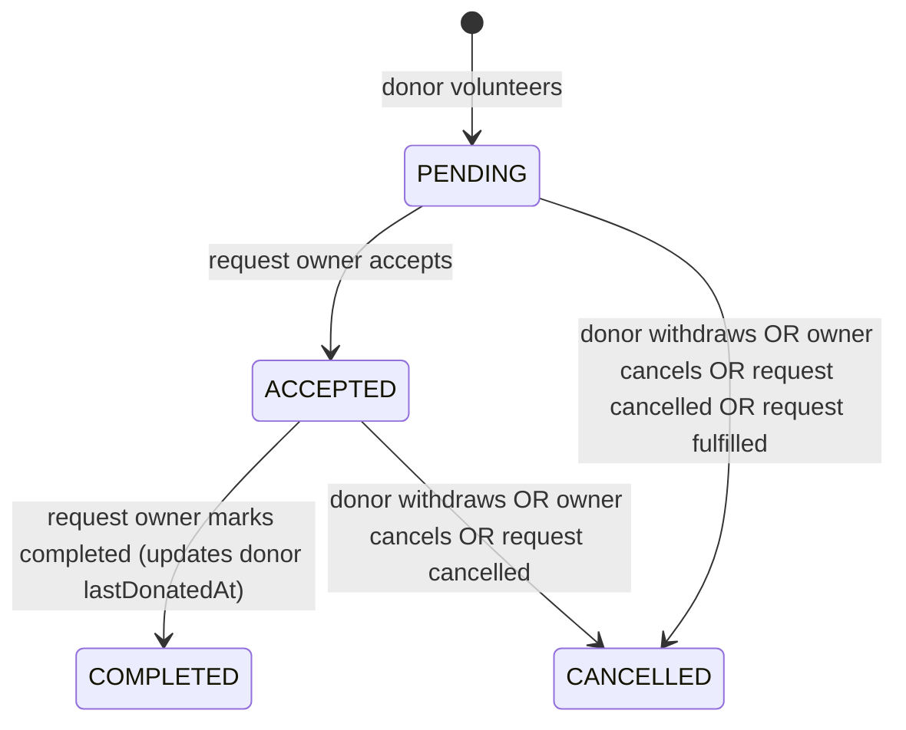

# BloodSync

A web application for coordinating blood donation requests in Bangladesh.
Requesters post blood needs; registered donors with compatible blood groups volunteer to donate.
An AI assistant can read a WhatsApp or SMS message and prefill the request form.

Live frontend: `https://blood-sync-ten.vercel.app/`
Live API: `https://bloodsync-an1h.onrender.com/api/health`
Repository: `https://github.com/sadiq1020/bloodSync`

---

## Table of contents

1. [Features](#1-features)
2. [Architecture](#2-architecture)
3. [Backend](#3-backend)
4. [Frontend](#4-frontend)
5. [Database](#5-database)
6. [API reference](#6-api-reference)
7. [AI assistant](#7-ai-assistant)
8. [Setup](#8-setup)
9. [Deployment](#9-deployment)
10. [Security](#10-security)
11. [Known limitations](#11-known-limitations)
12. [AI evaluation](#12-ai-evaluation)
13. [Performance](#13-performance)
14. [Screenshots](#14-screenshots)
15. [Demo accounts](#15-demo-accounts)

---

## 1. Features

- Blood request feed filtered by blood group, district, and urgency
- Donor search filtered by blood group, district, and area
- Donor ranking for each request (compatible blood groups, same district, eligibility score)
- Donation lifecycle: PENDING - ACCEPTED - COMPLETED or CANCELLED
- AI message parser: paste a WhatsApp or SMS text to prefill the request form
- Admin panel: user management, request list, block/unblock users
- Role-based access control (USER / ADMIN); role cannot be set at signup
- Session invalidation on block

---

## 2. Architecture

```
Browser
  |
  v
Vercel (Next.js frontend)
  |  rewrites /api/* -> Render backend
  v
Render (Express API, Node.js)
  |
  v
Neon (PostgreSQL, Prisma ORM)
  |
  +-- OpenRouter (AI model for text parsing)
```

Traffic path: browser -> Vercel rewrite -> Render -> app.
`trust proxy 1` is set in production so Express reads the real client IP from
`X-Forwarded-For`.

---

## 3. Backend

**Stack:** Node.js, Express, TypeScript, Prisma, Better Auth, Zod, Helmet, Pino, express-rate-limit

**Folder structure**

```
server/
  src/
    app.ts                  # Express app: middleware, routes, error handler
    server.ts               # HTTP listen entry point
    config/
      auth.ts               # Better Auth configuration
      env.ts                # Zod-validated environment variables
      openrouter.ts         # OpenAI-compatible client for OpenRouter
      prisma.ts             # Prisma client singleton
    constants/
      bloodGroups.ts
      districts.ts
    lib/
      bloodCompatibility.ts # Donor-to-patient compatibility rules
      donorRanking.ts       # Scoring and ranking of candidate donors
      eligibility.ts        # 90-day recovery period check
    middlewares/
      rateLimiter.ts        # General and AI-specific limiters
      requireAuth.ts        # Session check middleware
      requireRole.ts        # Admin role guard
      validate.ts           # Zod request validation middleware
    modules/
      admin/                # Admin user and request management
      ai/                   # Text parsing with OpenRouter
      auth/                 # Signup, login helpers
      donation/             # Volunteer, accept, complete, cancel
      donor/                # Donor profile CRUD and search
      health/               # /api/health (DB check) and /api/ping
      request/              # Blood request CRUD, feed, ranked donors
    scripts/
      evaluate-ai.ts        # Offline accuracy benchmark
      seed-admin.ts         # Admin account seed
    tests/
      ai-eval/
        samples.json        # 20 hand-written evaluation samples
      unit/                 # Jest unit tests (all test files)
  prisma/
    schema.prisma
    seed-admin.ts
    seed-demo.ts
  dist/                     # Compiled output (git-ignored)
  DEPLOYMENT.md
```

**Modules**

| Module | Responsibility |
| :--- | :--- |
| auth | Email/password signup and login via Better Auth |
| donor | Create, read, update donor profile; donor search |
| request | Create blood requests; feed and personal list; ranked donor suggestions |
| donation | Volunteer, accept, complete, cancel donations |
| admin | List and block/unblock users; list all requests |
| ai | Parse unstructured text into structured request fields |
| health | `/api/health` (Prisma query + 503 on failure) and `/api/ping` (instant 200) |

---

## 4. Frontend

**Stack:** Next.js 16.4.6, React 19.3.0, TypeScript, Tailwind CSS v4, shadcn/ui (base-ui/react, cmdk, lucide-react, Phosphor icons), TanStack Query v5, React Hook Form v7, Zod v4, nuqs v2, motion v14, Better Auth client v1.7, sonner v2

**Route list**

| Group | URL | Description |
| :--- | :--- | :--- |
| public (marketing) | `/` | Landing page |
| public (marketing) | `/compatibility` | Blood group compatibility chart |
| auth | `/login` | Login form + demo account buttons |
| auth | `/register` | Registration form |
| app (requires login) | `/requests` | Request feed with filters |
| app (requires login) | `/requests/new` | New request form with AI paste assistant |
| app (requires login) | `/requests/[id]` | Request detail, volunteer button, ranked donors |
| app (requires login) | `/my/requests` | Personal request list |
| app (requires login) | `/my/donations` | Personal donation history |
| app (requires login) | `/donors` | Donor search |
| app (requires login) | `/donor` | Donor profile management |
| admin | `/admin` | Admin dashboard |
| admin | `/admin/users` | User list with block/unblock |
| admin | `/admin/requests` | All requests list |

**Data pattern**

Server components fetch the first page of data on the server for instant render.
URL state (filters, page number) is managed with nuqs and survives browser navigation.
TanStack Query handles mutations and cache invalidation; `router.refresh()` is called after
mutations that affect server-rendered data.

**API proxy**

All `/api/*` requests from the browser are rewritten by Next.js to the Render backend URL
(`BACKEND_URL` environment variable). This keeps API calls on the same origin as the frontend
so session cookies are first-party and are sent automatically without `credentials: "include"`.

**Design**

Dark theme with Tailwind CSS v4. All interactive elements have visible focus rings.
Animations use the motion library and respect the user's `prefers-reduced-motion` setting.
Touch targets are at least 44 px.

**Demo login buttons**

When `NEXT_PUBLIC_DEMO_LOGIN=true`, a "Demo accounts" section is shown below the login form
with three buttons: Requester, Donor, Admin. Clicking one signs in directly using
`authClient.signIn.email` with the credentials from the corresponding `NEXT_PUBLIC_DEMO_*`
environment variables. A pending state is shown on the button while signing in.
Admin lands on `/admin`; the others on `/requests`, unless `?next` is set.

**Client folder tree**

```
client/
  src/
    app/
      (marketing)/          # Landing and compatibility pages
      (auth)/               # Login and register
      (app)/                # Authenticated app routes
      (admin)/              # Admin-only routes
      layout.tsx            # Root layout: TanStack Query provider, Toaster
      globals.css
    components/
      ui/                   # Base UI primitives
      forms/                # React Hook Form + Zod form components
      ...                   # Feature-level components
    lib/
      auth-client.ts        # Better Auth browser client
      api.ts                # Typed fetch wrappers
      utils.ts
    hooks/                  # Custom React hooks
  next.config.ts            # Rewrite proxy, security headers, bundle analyzer
  client/.env.example
```

---

## 5. Database

PostgreSQL hosted on Neon. Prisma is used for migrations, queries, and schema management.

**Models**

| Model | Key fields | Notes |
| :--- | :--- | :--- |
| User | id, name, email (unique), role (USER/ADMIN), isBlocked | Managed by Better Auth |
| Session | id, token (unique), userId, expiresAt | Managed by Better Auth |
| Account | id, accountId, providerId, userId | OAuth accounts (Better Auth) |
| Verification | id, identifier, value, expiresAt | Used by Better Auth internally |
| DonorProfile | id, userId (unique), bloodGroup, district, area, phone, isAvailable, lastDonatedAt | One per user |
| BloodRequest | id, requesterId, patientName, bloodGroup, unitsNeeded, hospital, district, area, urgency, neededBy, contactPhone, note, forSelf, status | Defaults to OPEN |
| Donation | id, requestId, donorId, status | Unique on (requestId, donorId) |

**Enums**

- BloodGroup: A+, A-, B+, B-, AB+, AB-, O+, O-
- Role: USER, ADMIN
- Urgency: NORMAL, URGENT, CRITICAL
- RequestStatus: OPEN, MATCHED, FULFILLED, EXPIRED, CANCELLED
- DonationStatus: PENDING, ACCEPTED, COMPLETED, CANCELLED

**Indexes**

| Model | Index |
| :--- | :--- |
| DonorProfile | `district`, `bloodGroup` |
| BloodRequest | `district`, `bloodGroup`, `status` |
| Donation | `status`; unique `(requestId, donorId)` |

---

## 6. API reference

All endpoints are prefixed with `/api`. The browser talks to the Next.js frontend, which
rewrites `/api/*` to the Render backend.

### Auth (Better Auth built-in routes)

| Method | Path | Description |
| :--- | :--- | :--- |
| POST | /api/auth/sign-up/email | Register (role defaults to USER, cannot be set by client) |
| POST | /api/auth/sign-in/email | Login |
| POST | /api/auth/sign-out | Logout |
| GET | /api/auth/get-session | Current session |

Better Auth applies its own built-in rate limiting to auth endpoints.

### Health

| Method | Path | Auth | Description |
| :--- | :--- | :--- | :--- |
| GET | /api/ping | None | Returns `{ "success": true }` immediately. No DB, no auth, no logging. Skips the general rate limiter. |
| GET | /api/health | None | Runs `SELECT 1` via Prisma. Returns 200 `{ "status": "ok" }` or 503 `{ "status": "error", "message": "..." }` |

### Donors

| Method | Path | Auth | Description |
| :--- | :--- | :--- | :--- |
| POST | /api/donors | USER | Create donor profile |
| GET | /api/donors/me | USER | Get own donor profile (includes phone) |
| PATCH | /api/donors/me | USER | Update donor profile |
| GET | /api/donors/search | USER | Search available, eligible donors. Never returns phone or email. Filters: bloodGroup, district, area, page, limit |

### Blood requests

| Method | Path | Auth | Description |
| :--- | :--- | :--- | :--- |
| POST | /api/requests | USER | Create a blood request |
| GET | /api/requests | USER | Feed: paginated list ordered by urgency then neededBy. Omits contactPhone. |
| GET | /api/requests/mine | USER | Own requests with donation counts |
| GET | /api/requests/:id | USER | Request detail. contactPhone revealed only to owner, admin, or donors with ACCEPTED/COMPLETED status. |
| PATCH | /api/requests/:id/cancel | USER (owner only) | Cancel OPEN or MATCHED request; cancels pending and accepted donations |
| GET | /api/requests/:id/donors | USER (owner or admin) | Top 20 ranked candidate donors for this request. Returns donor phone. |
| GET | /api/requests/:id/donations | USER (owner or admin) | All volunteers for this request with donor details and phone |

### Donations

| Method | Path | Auth | Description |
| :--- | :--- | :--- | :--- |
| POST | /api/requests/:id/volunteer | USER | Volunteer to donate. Requires donor profile, eligibility, compatibility. One volunteer entry per (request, donor). |
| GET | /api/donations/mine | USER | Own donation history |
| PATCH | /api/donations/:id/accept | USER (request owner) | Accept a PENDING donation. If accepted+completed count >= unitsNeeded, marks request MATCHED. |
| PATCH | /api/donations/:id/complete | USER (request owner) | Mark ACCEPTED donation as COMPLETED. Updates lastDonatedAt. If completed count >= unitsNeeded, marks request FULFILLED and cancels remaining PENDING donations. |
| PATCH | /api/donations/:id/cancel | USER (donor or request owner) | Cancel a PENDING or ACCEPTED donation. If request was MATCHED and accepted+completed count drops below unitsNeeded, reverts request to OPEN. |

### Admin

| Method | Path | Auth | Description |
| :--- | :--- | :--- | :--- |
| GET | /api/admin/users | ADMIN | List all users with pagination |
| PATCH | /api/admin/users/:id/block | ADMIN | Block a user (invalidates sessions) |
| PATCH | /api/admin/users/:id/unblock | ADMIN | Unblock a user |
| GET | /api/admin/requests | ADMIN | List all blood requests |

### AI

| Method | Path | Auth | Description |
| :--- | :--- | :--- | :--- |
| POST | /api/ai/parse-request | USER | Parse unstructured text into request fields. Rate limit: 10 per 10 minutes per user. |

### Rate limiting

| Limiter | Limit | Key |
| :--- | :--- | :--- |
| General | 600 requests per 15 minutes | IP address (skips `/api/ping`) |
| AI parse | 10 requests per 10 minutes | User ID (falls back to IP for unauthenticated requests) |
| Better Auth | Built-in (managed by Better Auth library) | Varies by endpoint |

---

## 7. AI assistant

**Endpoint:** `POST /api/ai/parse-request`

**Input:** `{ "text": "..." }` (10-1000 characters)

The service calls an LLM via OpenRouter with a structured system prompt.
The model returns JSON; the service validates it with Zod.
Phone numbers are extracted by a separate regex (`/(?:\+8801|01)[3-9]\d{8}/`) in the
server code, not by the model. The AI never submits a blood request; it only prefills
the form for the user to review.

**Response shape**

```json
{
  "fields": {
    "patientName": "string | null",
    "bloodGroup": "A+ | A- | B+ | B- | AB+ | AB- | O+ | O- | null",
    "unitsNeeded": "1-10 | null",
    "hospital": "string | null",
    "district": "string | null",
    "area": "string | null",
    "urgency": "NORMAL | URGENT | CRITICAL",
    "contactPhone": "string | null"
  },
  "missingFields": ["array of field names that are null"],
  "matchingDonorsCount": 0
}
```

`matchingDonorsCount` is the number of eligible, available donors that match the extracted
blood group and district.

**Model:** `<<FILL: production OpenRouter model id>>`
(The eval script and `.env.example` use `openrouter/free` as a placeholder.)

---

## 8. Setup

### Prerequisites

- Node.js >= 20
- PostgreSQL (local or Neon)
- An OpenRouter API key

### Environment variables

#### Server (`server/.env`)

| Variable | Local example | Production note |
| :--- | :--- | :--- |
| `PORT` | `5000` | Set by Render automatically |
| `NODE_ENV` | `development` | Set to `production` on Render |
| `DATABASE_URL` | `postgresql://...` | Neon pooled URL |
| `DIRECT_URL` | `postgresql://...` | Neon direct URL (migrations) |
| `BETTER_AUTH_SECRET` | (32+ random chars) | Generate with `openssl rand -hex 32` |
| `BETTER_AUTH_URL` | `http://localhost:5000` | Production: your Render service URL |
| `FRONTEND_URL` | `http://localhost:3000` | Production: your Vercel URL |
| `OPENROUTER_API_KEY` | `sk-or-v1-...` | From openrouter.ai |
| `OPENROUTER_MODEL` | `openrouter/free` | Production: `<<FILL>>` |
| `OPENROUTER_TIMEOUT_MS` | `30000` | |
| `ADMIN_EMAIL` | `admin@bloodsync.com` | Seed only |
| `ADMIN_PASSWORD` | `Admin@123456` | Seed only |
| `DEMO_PASSWORD` | `Demo@123456` | Seed only |

#### Client (`client/.env.local`)

| Variable | Local example | Production note |
| :--- | :--- | :--- |
| `NEXT_PUBLIC_APP_URL` | `http://localhost:3000` | Your Vercel URL |
| `BACKEND_URL` | `http://localhost:5000` | Your Render URL (server-side only) |
| `NEXT_PUBLIC_DEMO_LOGIN` | `false` | Set to `true` to show demo buttons |
| `NEXT_PUBLIC_DEMO_REQUESTER_EMAIL` | `demo.requester1@bloodsync.test` | |
| `NEXT_PUBLIC_DEMO_DONOR_EMAIL` | `demo.donor1@bloodsync.test` | |
| `NEXT_PUBLIC_DEMO_PASSWORD` | `Demo@123456` | |
| `NEXT_PUBLIC_DEMO_ADMIN_EMAIL` | `admin@bloodsync.com` | |
| `NEXT_PUBLIC_DEMO_ADMIN_PASSWORD` | `Admin@123456` | |

### Running locally

**Server**

```bash
cd server
cp .env.example .env        # fill in your values
npm install
npm run db:deploy           # run migrations
npm run seed                # create admin account
npm run seed:demo           # optional: create demo accounts
npm run dev
```

**Client**

```bash
cd client
cp .env.example .env.local  # fill in your values
npm install
npm run dev
```

---

## 9. Deployment

See [server/DEPLOYMENT.md](server/DEPLOYMENT.md) for the full step-by-step guide including:

- Render build command (`npm ci && npm run build`) and start command (`node dist/server.js`)
- Vercel environment variable table
- Running migrations and seeds against Neon using Windows PowerShell syntax
- Clearing environment variables after seeding (`Remove-Item Env:NAME`)

**Summary**

| Service | Platform | Plan |
| :--- | :--- | :--- |
| Database | Neon | Free tier |
| Backend | Render | Free Node web service |
| Frontend | Vercel | Hobby |

Render free instances spin down after inactivity. Set up an uptime monitor to ping
`<<FILL: Render URL>>/api/ping` every 5 minutes to keep the instance warm.
`/api/ping` has no database query and no logging, so it does not count toward rate limits.

---

## 10. Security

- **Role protection:** `role` and `isBlocked` fields have `input: false` in Better Auth config.
  Clients cannot set them at signup or through any user-facing endpoint.
- **Session invalidation:** When an admin blocks a user, Better Auth invalidates all active sessions.
- **Admin route guard:** All `/api/admin/*` routes require `role === ADMIN` checked server-side.
- **Open redirect protection:** The `?next` query parameter on `/login` is validated against an
  allowlist of same-origin paths before redirect.
- **Input validation:** All request bodies and query strings are validated with Zod before
  reaching service or database layer.
- **HTTP security headers:** Helmet sets standard headers on the backend. Next.js config adds
  `X-Content-Type-Options`, `Referrer-Policy`, `X-Frame-Options`, and `Permissions-Policy`
  on the frontend.
- **Secure cookies:** `useSecureCookies: true` and `secure: true` cookie attributes are set
  when `NODE_ENV=production`. SameSite defaults to `Lax` (safe for the Vercel -> Render proxy).
- **Trust proxy:** `app.set("trust proxy", 1)` is set in production so Express reads the real
  client IP from the `X-Forwarded-For` header added by Vercel.
- **Privacy:** Donor search (`GET /api/donors/search`) never returns phone or email.
  `GET /api/requests/:id` returns `contactPhone` only to the request owner, admins, and
  donors whose donation status is ACCEPTED or COMPLETED.
  `GET /api/requests/:id/donors` (ranked list) and `GET /api/requests/:id/donations`
  (volunteer list) return donor phones only to the request owner or an admin.

---

## 11. Known limitations

- No email verification flow. The `emailVerified` field exists in the schema (created by
  Better Auth) but no verification tokens are generated or sent. Users can sign in
  immediately after registration.
- No password reset flow.
- No push or email notifications. Donors are not alerted when accepted.
- No real-time updates. The feed and request detail pages require a manual refresh or
  navigating away and back to show changes made by other users.
- Donor search returns only available and eligible donors. A donor who donated recently
  or set themselves unavailable does not appear even if they would otherwise match.
- The general rate limiter is keyed by IP. Behind Vercel's proxy all users share a small
  set of egress IPs, which is why the limit is set to 600 requests per 15 minutes.
- Render free tier spins down after inactivity (approximately 15 minutes). Cold starts
  add 10-30 seconds of latency on the first request.
- No integration tests. All server tests are unit tests with mocked Prisma or pure functions.
  The frontend has no automated tests.
- No file upload or image support.
- No internationalisation. The UI is in English; the AI prompt handles Bangla and mixed input.
- Blood request area and hospital fields are free text; there is no canonical list.

---

## 12. AI evaluation

Evaluated on 20 hand-written samples covering English, Bangla, and mixed input with phone numbers.
Samples are in `server/src/tests/ai-eval/samples.json`.
The evaluation script is `server/src/scripts/evaluate-ai.ts`.

Model tested: `<<FILL: production model id>>`
Run date: `<<FILL: YYYY-MM-DD>>`

| Metric | Value |
| :--- | :--- |
| Total samples | 20 |
| Fully correct samples | `<<FILL>>` |
| Overall field accuracy | `<<FILL>>` |
| Blood group accuracy | `<<FILL>>` |
| District accuracy | `<<FILL>>` |
| Urgency accuracy | `<<FILL>>` |
| Average response time | `<<FILL>> ms` |

The full report (auto-generated by the eval script) is in `docs/ai-evaluation.md`.

---

## 13. Performance

Lighthouse scores (measured on the production Vercel deployment):

| Page | Performance | Accessibility | Best Practices | SEO |
| :--- | :--- | :--- | :--- | :--- |
| Landing (`/`) | `<<FILL>>` | `<<FILL>>` | `<<FILL>>` | `<<FILL>>` |
| Request feed (`/requests`) | `<<FILL>>` | `<<FILL>>` | `<<FILL>>` | `<<FILL>>` |
| New request (`/requests/new`) | `<<FILL>>` | `<<FILL>>` | `<<FILL>>` | `<<FILL>>` |

---

## 14. Screenshots

`<<FILL: replace with actual screenshot images>>`

| Screen | Preview |
| :--- | :--- |
| Landing page | `<<FILL>>` |
| Request feed | `<<FILL>>` |
| Request detail with ranked donors | `<<FILL>>` |
| Admin user management | `<<FILL>>` |

---

## 15. Demo accounts

All demo accounts use the password set in `DEMO_PASSWORD` (default: `Demo@123456`).
The admin password is set in `ADMIN_PASSWORD` (default: `Admin@123456`).

**Admin**

| Email | Password |
| :--- | :--- |
| admin@bloodsync.com | Admin@123456 (from ADMIN_PASSWORD seed var) |

**Requesters**

| Email | Password |
| :--- | :--- |
| demo.requester1@bloodsync.test | Demo@123456 |
| demo.requester2@bloodsync.test | Demo@123456 |

**Donors (from `server/prisma/seed-demo.ts`)**

Donors 1-12: eligible (never donated), available.
Donors 13-14: eligible (donated >90 days ago), available.
Donors 15-17: ineligible (<90 days since last donation), available (will not appear in search).
Donors 18-20: unavailable (isAvailable: false).

| # | Email | Blood group | District | Eligible | Available |
| :- | :--- | :--- | :--- | :--- | :--- |
| 1 | demo.donor1@bloodsync.test | O+ | Dhaka | yes | yes |
| 2 | demo.donor2@bloodsync.test | A+ | Chittagong | yes | yes |
| 3 | demo.donor3@bloodsync.test | B+ | Rajshahi | yes | yes |
| 4 | demo.donor4@bloodsync.test | AB+ | Mymensingh | yes | yes |
| 5 | demo.donor5@bloodsync.test | O- | Khulna | yes | yes |
| 6 | demo.donor6@bloodsync.test | A- | Barisal | yes | yes |
| 7 | demo.donor7@bloodsync.test | B- | Dhaka | yes | yes |
| 8 | demo.donor8@bloodsync.test | AB- | Rangpur | yes | yes |
| 9 | demo.donor9@bloodsync.test | O+ | Sylhet | yes | yes |
| 10 | demo.donor10@bloodsync.test | A+ | Comilla | yes | yes |
| 11 | demo.donor11@bloodsync.test | B+ | Gazipur | yes | yes |
| 12 | demo.donor12@bloodsync.test | AB+ | Dhaka | yes | yes |
| 13 | demo.donor13@bloodsync.test | O+ | Chittagong | yes (120 d) | yes |
| 14 | demo.donor14@bloodsync.test | B+ | Rajshahi | yes (105 d) | yes |
| 15 | demo.donor15@bloodsync.test | A+ | Sylhet | no (30 d) | yes |
| 16 | demo.donor16@bloodsync.test | B+ | Khulna | no (45 d) | yes |
| 17 | demo.donor17@bloodsync.test | O- | Barisal | no (60 d) | yes |
| 18 | demo.donor18@bloodsync.test | A- | Rangpur | yes | no |
| 19 | demo.donor19@bloodsync.test | AB+ | Comilla | yes | no |
| 20 | demo.donor20@bloodsync.test | B- | Gazipur | yes | no |

---

## Tests

Server: 7 test suites, 120 tests, all unit tests (mocked Prisma or pure functions). No integration tests.
Frontend: no automated tests.

Run server tests:

```bash
cd server && npm test
```

**Test files**

| File | Tests | What it covers |
| :--- | :--- | :--- |
| eligibility.test.ts | 6 | 90-day recovery period logic |
| bloodCompatibility.test.ts | 75 | Donor-to-patient compatibility matrix |
| donorRanking.test.ts | 5 | Donor scoring and ranking |
| donationStatus.test.ts | 5 | Donation status transition guards |
| admin.test.ts | 16 | Admin service: block/unblock, list users |
| ai.test.ts | 9 | AI service: phone extraction, district normalization, blood group normalization |
| ping.test.ts | 4 | GET /api/ping: status, body, no auth required, no DB |

---

## Request status diagram



## Donation status diagram


